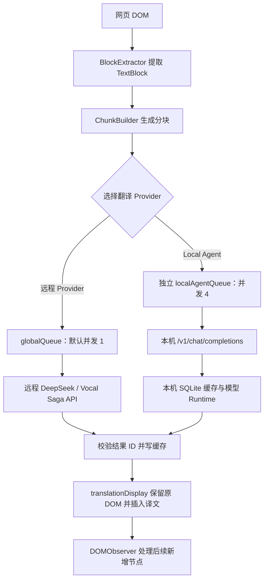
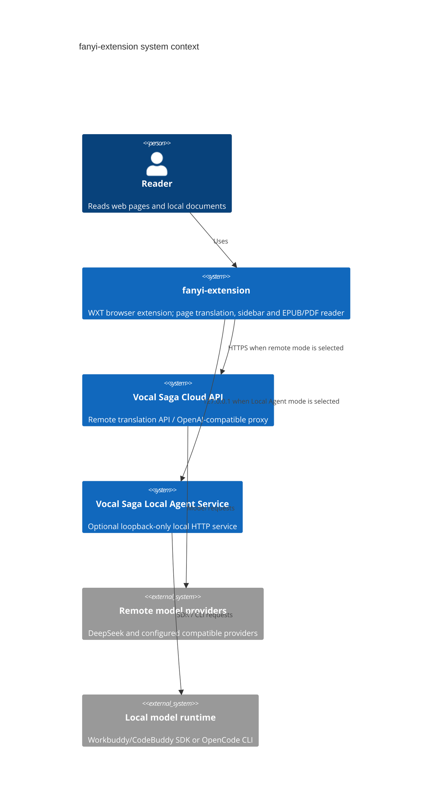
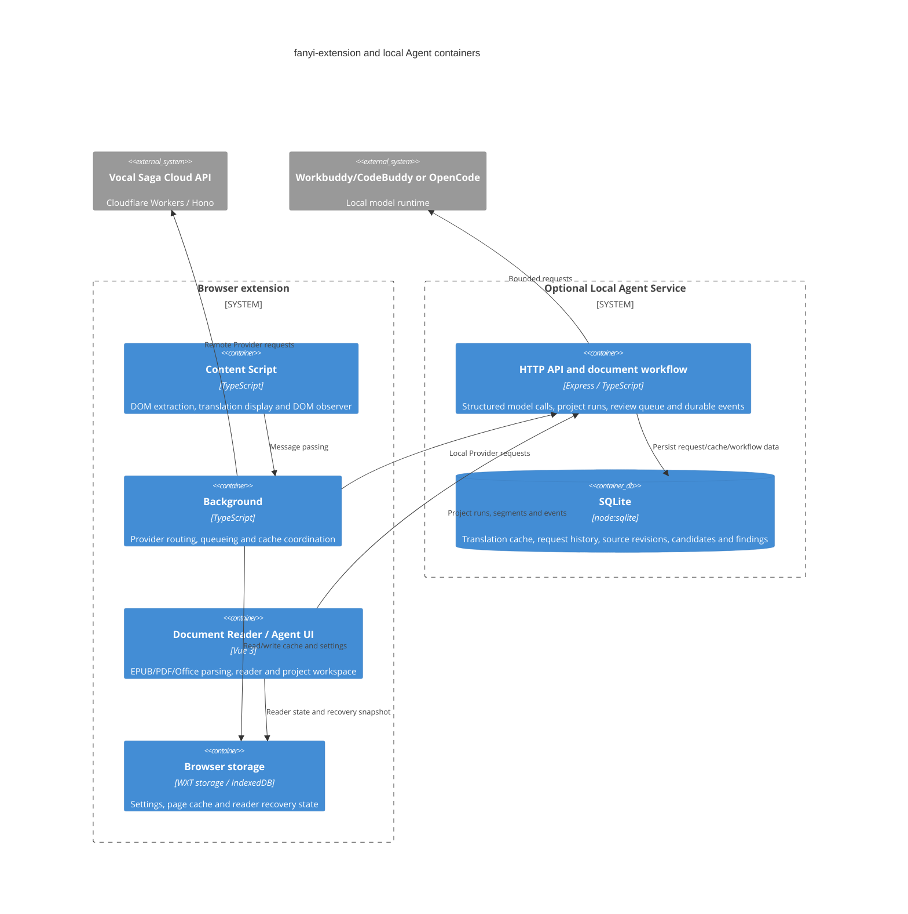
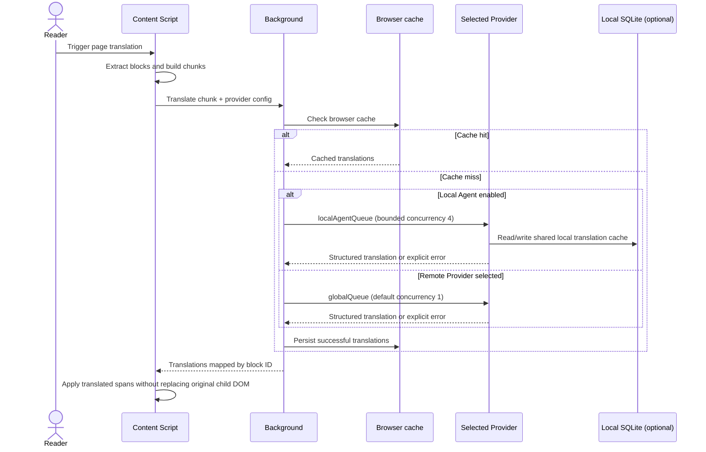
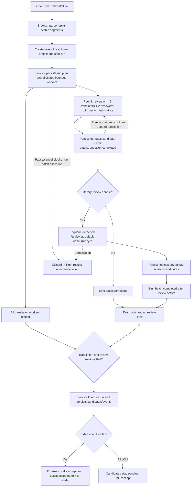

# 🌐 简简单单中英文翻译 - 浏览器插件

支持 Chrome, Firefox, Android Firefox，基于 DeepSeek LLM 的文档级翻译，采用完整的上下文理解，提供高质量的翻译体验。

Firefox安装（支持Android Firefox）：搜索”简简单单中英文翻译“， https://addons.mozilla.org/en-US/firefox/addon/简简单单中英文翻译/

Chrome：需要自己build
```
  npm run build
```

## ✨ 核心功能

- **全文翻译** - 文档级翻译，保持上下文连贯
- **双语对照** - 不破坏原页面布局、链接和格式
- **站点定制规则** - 针对不同网站优化翻译策略
- **流式响应** - 边译边显，无需等待整段完成
- **术语表提取** - 自动识别专有名词，全文统一译法
- **DeepSeek LLM 引擎** - 高质量 AI 翻译
- **本地缓存** - 7 天 TTL，避免重复请求
- **选区翻译** - 选中任意文本即时翻译

## 📦 安装

### Chrome
1. 打开 `chrome://extensions/`
2. 启用"开发者模式"
3. 点击"加载已解压的扩展程序"
4. 选择 `output/chrome-mv3/` 目录

### Firefox
1. 打开 `about:debugging#/runtime/this-firefox`
2. 点击"临时载入附加组件"
3. 选择 `output/firefox-mv2/manifest.json`

## ⚙️ 配置

1. 点击扩展图标打开设置
2. 填入你的 DeepSeek API Key
3. 设置源语言和目标语言
4. 选择翻译模式（双语对照 / 仅译文）

## 本机 Workbuddy / OpenCode Provider（可选）

扩展可把翻译、侧栏对话和 EPUB/PDF 的书籍实体分析与 Reviewer 请求交给本机服务，不需要配置 DeepSeek API Key。这个 Provider 与远程 Vocal Saga 服务相互独立；启用“使用本机 Workbuddy/OpenCode 翻译”后，本机模型调用失败会明确报错或保留已有初译，不会偷偷回退到远程服务。关闭本机 Provider 后，原有远程/DeepSeek 路径继续可用。

本机模式返回 HTTP 502 时，扩展日志会显示本机错误类型、request ID 和模型输出长度；本机终端使用同一 request ID 输出请求阶段、provider/model、耗时和堆栈。若出现“返回内容不是有效 JSON”，请查看终端中 `invalid-json` 的响应预览，或检查 `GET /api/history?limit=30`。默认只在解析失败时记录最多 600 字符预览；设置 `LOCAL_AGENT_LOG_RESPONSE_PREVIEW=false` 可关闭。

### 启动本机服务

在 macOS 安装 Node.js 22.13 或更新的 Node 22 版本，然后在 `vocal-saga` 仓库运行：

```bash
npm run local-agent:install
npm run local-agent:start
```

默认监听 `http://127.0.0.1:8789`。需事先完成 Workbuddy/CodeBuddy SDK 登录，或安装并登录 OpenCode CLI。服务只绑定 loopback，不要通过局域网地址、反向代理或隧道公开。

### 配置扩展

在 Popup 中开启“使用本机 Workbuddy/OpenCode 翻译”，选择本机运行时，并点击“测试本机服务连接”。本机服务地址通常保持默认值；模型覆盖和 Token 都是可选项。如果服务端设置了 `LOCAL_AGENT_TOKEN`，扩展中必须填写相同 Token。

本机服务使用 SQLite 保存请求历史、翻译缓存和文档恢复副本，默认数据库位于 `~/.vocal-saga-local-agent/local-agent.sqlite`。请求正文是否记录由 `LOCAL_AGENT_STORE_CONTENT` 控制；翻译缓存和文档检查点是独立业务数据，不受该选项关闭影响。更多配置、数据上限和清理方法见 [本机服务说明](https://github.com/devweekly/vocal-saga/blob/main/local-agent-service/README.md)。

质量审计与定点返工使用服务端现有项目 API。跨仓库字段、Run 状态、过期报告保护和回归要求统一记录在[本机服务与扩展质量审计契约](https://github.com/devweekly/vocal-saga/blob/main/docs/LOCAL_AGENT_EXTENSION_QUALITY_CONTRACT.md)；修改其中一端时应同步检查另一端。

EPUB/PDF 文件选择和容器解析仍由扩展在浏览器中处理；本机服务负责本机模型调用、文学分析/审校、SQLite 翻译缓存以及文档检查点。阅读器优先使用 IndexedDB，SQLite 作为附加恢复副本。当开启“本机 Agent”时，EPUB/PDF 阅读页和“翻译 Agent”共用一个 workspace：workspace 项目 SQLite 保存来源版本、Prompt 版本、运行/批次状态、候选译文、采纳译文、人工修订与完整事件记录；原始文件按来源版本存放在项目目录。阅读页和 Agent Tab 都通过同一 Translation Agent 运行；任务完成后会自动把有效候选写入当前译文，并同步回阅读器，不需要用户逐条采纳或预先填写译文。重新翻译时，同一原文版本已有的人工修订优先保留；用户仍可在“更多选项”中按需手工纠正、查看运行历史或重试失败项。两个入口使用同一份 system/user Prompt、语言方向、模型、术语表和书籍记忆。旧阅读器已有译文会在创建/关联 workspace 时导入，后续以 workspace 中当前来源版本的已采纳译文为准。翻译 Agent 的“更多选项 → 全书质量审计”可以扫描缺译、规范译名冲突/漂移、疑似英文残留、数字/单位差异和重复表达；可返工项会创建新的候选 Run，规范译名配置冲突必须先人工统一，审计不会直接覆盖已有译文，报告保存在本机项目数据库并绑定来源版本。注意：扩展可打开不超过 20 MiB 的文件。扩展写入 SQLite 恢复副本时，会将单个文档检查点的序列化 JSON 控制在 5 MiB 以内；这是客户端检查点限制，不是 project API 的 HTTP 限制。`/api/documents/*` JSON 请求体上限为 100 MiB，其他本机服务 JSON API 为 24 MiB，原始源文件上传上限为 20 MiB。大文档仍可使用 IndexedDB，但 SQLite 可能无法备份完整快照。如果 IndexedDB 也不可用，该文档刷新后可能无法恢复。清空翻译缓存不等于删除文档检查点或请求历史；要清除所有 SQLite 中的本机内容，可在服务停止后删除整个数据库文件。

## 🎮 快捷键

| 操作 | 快捷键 |
|------|--------|
| 翻译页面 | `Alt+T` |
| 恢复原文 | `Alt+R` |
| 切换译文显示 | `Alt+V` |

> Firefox 不识别 `commands` —— 快捷键需通过 `about:addons` 页面配置。

## 📐 站点定制规则 (Site Rules)

插件支持针对不同网站定制翻译规则，确保特定术语、UI 标签、品牌名称等不被错误翻译。

### 规则目录结构

```
src/rules/
├── types.ts              # 规则类型定义
├── index.ts              # 规则注册中心
├── github-rules.ts       # GitHub 站点规则
├── reddit-rules.ts       # Reddit 站点规则
├── hackernews-rules.ts   # Hacker News 站点规则
└── fortune-rules.ts      # Fortune 站点规则
```


### 最终 Prompt 组成

翻译时发送给 LLM 的 prompt 由以下部分组合而成：

```
┌─────────────────────────────────────────────────────┐
│  System Prompt (基础翻译指令)                         │
├─────────────────────────────────────────────────────┤
│  Professional translator. Translate blocks to       │
│  Simplified Chinese.                                │
│                                                     │
│  Rules:                                             │
│  - Keep IDs unchanged                               │
│  - Consistent terminology                           │
│  - Natural translation                              │
│  - No omissions                                     │
│  - Return JSON only                                 │
├─────────────────────────────────────────────────────┤
│  Site-specific rules (站点定制规则，动态注入)          │
├─────────────────────────────────────────────────────┤
│  Do NOT translate the following terms, keep as-is:  │
│  Releases, Packages, license, MIT, README, ...      │
│                                                     │
│  This is a GitHub page. Keep UI navigation terms,   │
│  file extensions, and code-related vocabulary       │
│  untranslated. Preserve brand names and technical   │
│  terms.                                             │
├─────────────────────────────────────────────────────┤
│  Glossary (术语表，前置抽取的专有名词对照)             │
├─────────────────────────────────────────────────────┤
│  Use these term mappings consistently:              │
│  "API" → "接口"                                     │
│  "Repository" → "仓库"                              │
├─────────────────────────────────────────────────────┤
│  User Message (待翻译内容)                           │
├─────────────────────────────────────────────────────┤
│  Translate and return JSON:                         │
│  [{"id":"b1","text":"Hello World"}]                 │
└─────────────────────────────────────────────────────┘
```

**Prompt 构建流程：**

1. **基础系统提示** - 固定的翻译规则和输出格式要求
2. **站点规则注入** - 根据当前页面 URL 匹配对应规则，将 `documentTerms` 和 `promptInstructions` 追加到 system prompt
3. **术语表注入** - 前置调用 LLM 抽取专有名词及其译法，注入到 prompt 保证全文一致
4. **用户消息** - 待翻译的文本块 JSON

无匹配站点规则时，仅使用基础系统提示和术语表。

## 🏗️ 技术架构

### 网页翻译流水线



远程 DeepSeek 的单并发队列与本机队列分开。本机 Provider 失败时直接报错，不会自动切换到远程翻译服务。
### 目录结构

```text
src/
├── components/                 # 页面内 Vue 控件
├── entrypoints/
│   ├── background.ts           # 后台消息路由、缓存与 Provider 调度
│   ├── content.ts              # 内容脚本入口
│   ├── content/                # 页面翻译控制器、分块调度、服务端模式
│   ├── document/               # EPUB/PDF 阅读器与 Document Agent workspace
│   ├── popup/                  # 配置界面
│   ├── service/                # DeepSeek / 对话客户端与响应解析
│   └── utils/
│       ├── blockExtractor/     # TreeWalker、过滤规则、块类型与统计
│       ├── document/           # 文档分块、解析器、导出与阅读状态
│       ├── cacheKey.ts
│       ├── cacheManager.ts
│       ├── chunkBuilder.ts
│       ├── contentHelper.ts
│       ├── domObserver.ts
│       ├── glossaryExtractor.ts
│       ├── localAgentHealth.ts
│       ├── offlineQueue.ts
│       ├── shardedStorage.ts
│       ├── singleflight.ts
│       ├── translateApi.ts
│       ├── translationDisplay.ts
│       └── translationQueue.ts
├── rules/                      # 站点定制规则
├── styles/                     # 扩展 UI 样式
└── __tests__/                  # Vitest 测试位于 src/__tests__
```

实际解析器、缓存与队列实现以这些目录中的源码为准；README 只列出主要结构，不要求逐文件罗列。

### 关键模块说明

| 模块 | 职责 |
|------|------|
| `entrypoints/background.ts` | 后台消息路由、缓存管理和 Provider 路由；远程与本机请求使用不同队列 |
| `entrypoints/content.ts` | 内容脚本：注入页面、提取 DOM 块、应用/还原翻译、监听 DOM 变化 |
| `entrypoints/service/deepseek.ts` | DeepSeek API 客户端（流式 + 非流式 + 术语表抽取） |
| `entrypoints/service/streamParser.ts` | SSE 协议逐行解析，跨 `read()` 分片累积 |
| `entrypoints/utils/translationDisplay.ts` | 把翻译结果以 `<span class="fanyi-original">/fanyi-translation` 包裹原元素，**不修改原 DOM 子节点**，链接、`<strong>`、`<code>` 等内联元素完整保留 |
| `entrypoints/utils/blockExtractor/` | `TreeWalker` 遍历 DOM 提取 `TextBlock`；规则和类型分文件维护 |
| `entrypoints/utils/chunkBuilder.ts` | 文本块按字符数上限分批 |
| `entrypoints/utils/domObserver.ts` | `MutationObserver` 增量翻译新出现节点 |
| `entrypoints/utils/glossaryExtractor.ts` | 调用 LLM 抽取专有名词 + 译法 |
| `entrypoints/utils/translationQueue.ts` | 可配置有界队列；远程 globalQueue 默认并发 1，本机网页翻译另用并发 4 的队列 |
| `entrypoints/utils/cacheManager.ts` | `@wxt-dev/storage` 缓存（7 天 TTL，简单 hash key） |
| `entrypoints/utils/config.ts` | `@wxt-dev/storage` 持久化配置 |

### 翻译模式

- **bilingual**（双语对照）：在原元素下追加 `.fanyi-translation` span，原文继续可见。
- **target**（仅译文）：原元素下追加 `.fanyi-original` span（`display:none`）+ `.fanyi-translation` span。

两种模式都通过 `translationDisplay.ts` 实现，**不破坏原 DOM 子节点**，原文中的 `<a>`、`<strong>`、`<code>`、`` 等内联元素保持原状和可交互。

### 多浏览器兼容

| 浏览器 | Manifest | 快捷键 | 备注 |
|--------|----------|--------|------|
| Chrome | v3 | 浏览器层 `Alt+T/R/V` | 完整功能 |
| Firefox (桌面) | v2 | 需在 `about:addons` 配置 | 无 `contextMenus` API |
| Firefox (Android) | v2 | 触屏手势 | 触屏优先 |

构建钩子（`wxt.config.ts:63`）会重写 HTML 中的绝对资源路径为相对路径，跨 target 兼容。

## 系统架构与关键流程

### C4 — 系统上下文



### C4 — 扩展内部与本机服务容器



### 时序图 — 网页翻译的 Provider 路由



### 流程图 — EPUB/PDF project-based Agent



> Local Agent mode is an explicit routing choice. Local model failures do not trigger automatic fallback to the cloud/DeepSeek provider. Both worker caps are upper bounds constrained by `LOCAL_AGENT_POOL_SIZE`; each batch uses an independent Session scope.

## 📝 开发

### 命令

```bash
pnpm install         # 触发 wxt prepare，生成 .wxt/ 类型
pnpm compile         # vue-tsc --noEmit —— 提交前必跑
pnpm test            # vitest run (jsdom)
pnpm test:watch      # 监听模式
pnpm dev             # Chrome 开发模式 (HMR)
pnpm dev:firefox     # Firefox 开发模式
pnpm build           # 构建 Chrome (含 prebuild 类型检查)
pnpm build:firefox   # 构建 Firefox
pnpm zip             # 打包 Chrome 为 .zip
pnpm zip:firefox     # 打包 Firefox 为 .zip
```

`pnpm compile` 必须通过后再 `pnpm build`。

### 调试 / Gotchas

- **不要在 `entrypoints/` 下放 `.test.ts`** —— WXT 用 `picomatch` 扫描 entrypoint，basename 冲突会直接 build 失败。所有测试在 `src/__tests__/`。
- **不要手动设置 `TreeWalker.currentNode`** —— 真实 Chrome/Firefox 与 jsdom 行为不同（见 `blockExtractor.ts` 注释）。
- **配置写入**：Vue refs 是 Proxy 代理，写入 `@wxt-dev/storage` 时用 `JSON.parse(JSON.stringify(...))` 剥离 Proxy。
- **Cache key**：非加密 hash，仅用于去重；TTL 7 天。
- **Chunk 调度**：Provider 路径不同。远程 DeepSeek 使用 `globalQueue`（并发 1、最多重试 2 次、重试间隔 1 秒）；网页本机 Provider 使用独立的 4 并发队列。Project-based 文档 Agent 在四槽位下默认分配 2 个翻译 worker + 2 个审校 worker；关闭审校时翻译可使用最多 4 个槽位。
- **Popup UI**：`Element Plus` + 自定义 `theme.css`。

### 添加新站点规则

1. 在 [`src/rules/`](src/rules/) 下新建 `xxx-rules.ts`，导出 `SiteRule`。
2. 在 [`src/rules/index.ts`](src/rules/index.ts) 的 `RULES` 数组中注册。
3. 运行 `pnpm compile` 验证类型，`pnpm test` 验证现有测试仍通过。
