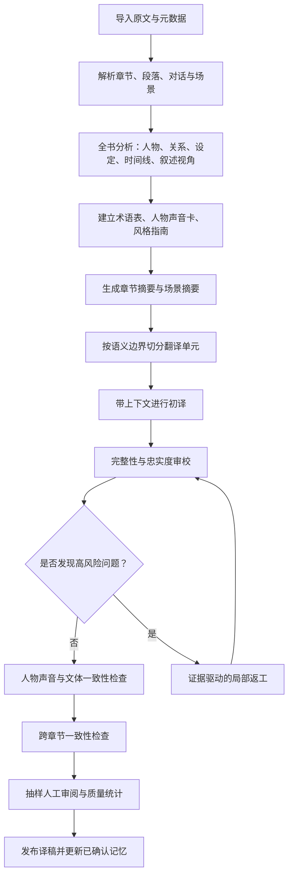

# 面向小说离线翻译的 Flash 模型质量工程：WMT 2026 获奖系统与最新研究分析

**报告日期：2026-10-16**  
**目标场景：** 使用 DeepSeek-V4.1-Flash 一类低成本、较小或偏吞吐优化的模型，进行非实时的长篇小说翻译。本文以英译中为主要示例，方法也适用于其他语言方向。

## 1. 执行摘要

核心结论是：**小说翻译的质量上限，不应只靠更长的提示词或一次生成来争取，而应通过“全书级上下文资产 + 文档级分块 + 分阶段翻译 + 有针对性的审校 + 可测量的质量门禁”来提高。** Flash 模型即使单次生成能力不如更大的旗舰模型，也可能通过更好的上下文管理、术语与人物约束、候选比较、错误检测和选择性返工，获得明显更好的最终译稿。

WMT 2026 的重要启示不是简单地“获奖模型用了某个提示词”，而是：模型专门化、训练数据与质量导向训练、文档级上下文、指令遵循、候选选择、质量估计，以及可复现的人类评价，正在共同决定系统表现。WMT 的通用新闻、社交和口语任务与小说不同，竞赛结果不能直接等同于文学翻译排名；但其系统工程方法值得借鉴。

建议优先采用以下路线：

1. **先建立小说的“翻译项目记忆”**：人物关系、人物声音、专名、世界观、时间线、叙述视角、文体规范和已确认译例。
2. **按语义场景而不是固定字数机械切块**：每次翻译保留前后文、章节摘要、相关人物卡和术语；尽量让完整段落与对话轮次留在同一块中。
3. **翻译与审校分离**：第一遍忠实翻译；第二遍只检查遗漏、误译、指代、人物声音、术语和文体，不让审校阶段随意重写原意。
4. **使用低成本的质量筛查，而不是无差别多轮润色**：让模型指出可定位的风险并引用原文证据；仅对高风险段落返工。
5. **建立小型人工黄金集**：从不同人物、叙述方式、动作场景、文化负载表达和长距离照应中抽样，对比提示词、分块策略与审校策略。不要只凭“读起来顺”判断。
6. **把风格质量与语义忠实度分开评分**：流畅、优美的译文仍可能漏译、增译或改写人物性格。最终选择应同时看准确性、完整性、自然度、声音区分度和全书一致性。

---

## 2. WMT 2026：获奖系统与可迁移的设计思路

### 2.1 先区分竞赛赛道与证据强度

WMT（Conference on Machine Translation）是机器翻译研究与共享任务的重要评测平台。WMT 2026 的通用机器翻译任务覆盖多个语言方向和文体，强调文档级测试，并增加了指令上下文能力评估，例如正式/非正式语气、术语表、结构化内容和非标准情绪表达；评估侧也强调对所有系统开展动态对比式人工评估，而非只依赖自动指标筛选。[WMT26 General MT 任务说明](https://www2.statmt.org/wmt26/translation-task.html)

截至本报告日期，WMT26 官方论文目录已公开相关系统论文，会议安排在 2026 年 10 月 28—29 日。对结果的引用应区分官方共享任务结论、论文中的系统描述和媒体报道；不同语言方向的排名不应混为一个“全球唯一冠军”。[WMT26 论文目录](https://www2.statmt.org/wmt26/papers.html) [WMT26 会议主页](https://www2.statmt.org/wmt26/)

### 2.2 Lumen：质量导向训练与指令专门化

WMT26 论文目录收录了 **“Lumen at WMT2026: Instruction-Specialized Translation via Quality-Aware Training and On-Policy Distillation”**。从论文题目和官方目录可确认，其方向是指令专门化翻译、质量感知训练和 on-policy distillation（策略分布上的蒸馏）。媒体在 2026 年 10 月 15 日报道，阿里提交的 Qwen-MT-Lumen 在受限赛道获得综合领先评价，并在多个翻译方向取得靠前名次。[WMT26 论文目录](https://www2.statmt.org/wmt26/papers.html) [2026-10-15 结果报道](https://www.doit.com.cn/ai/859799774556229.html)

**可迁移的启示：**

- **翻译是一个需要专门化的任务。** 通用模型会写作，不代表它会稳定地遵循翻译约束。翻译指令应明确区分忠实度、风格、格式和术语等目标。
- **质量导向的数据比堆砌普通平行句更有针对性。** 对小说场景，可以积累人工确认的高质量段落、术语决策、人物声音样例和典型错误修订记录。
- **蒸馏的价值是把高质量行为迁移到较低成本模型。** 如果未来允许本地微调，可用强模型生成候选，再由人工筛选与编辑，形成高质量训练数据；不要直接把未经核验的强模型输出当作金标准。
- **竞赛级训练路线不等于个人项目必须训练模型。** 在没有大量授权语料、GPU 和评估预算时，先做上下文工程、流程设计与错误驱动返工，通常更务实。

### 2.3 Wayfinder：翻译 Agent 的系统级思路

同一份 WMT26 结果报道将 Wayfinder 描述为翻译 Agent 系统，并称其在非受限赛道取得总体领先评价。[结果报道](https://www.doit.com.cn/ai/859799774556229.html) 这类系统的价值在于把翻译从“模型一次输出”变为有步骤、有工具、有选择的工作流。

**对小说翻译的合理借鉴不是照搬竞赛系统，而是拆分职责：**

- 项目规划：识别文体、叙述视角、人物、术语和潜在歧义。
- 翻译执行：以明确的上下文和约束生成译文。
- 质量检查：针对遗漏、误译、人物声音和一致性分别检查。
- 返工决策：根据错误风险决定是否重新翻译，而不是每段都无条件润色。
- 记忆更新：只有经确认的术语、人物设定和译例才进入长期项目记忆。

需要注意：Agent 步骤越多，不一定质量越高。多个模型互相改写可能导致语义漂移、风格趋同和不必要的增译。每个步骤都应有明确输入、输出、职责边界与停止条件。

### 2.4 其他 WMT26 方向：质量估计、压缩与候选比较

WMT26 论文目录还包含自动翻译质量评估、模型压缩，以及对多条译文进行对比式人工评估的研究。官方目录中有 **“Contrastive ESA: Human Evaluation of Multiple Translations at Once”**，也有关于紧凑开源模型作为质量评估器、量化推理部署取舍的论文。[WMT26 论文目录](https://www2.statmt.org/wmt26/papers.html)

对离线小说翻译的启示：

- **候选比较往往比空泛打分更有用。** 对难句生成两个或三个候选，让评审依据原文比较语义、节奏、人物语气和自然度，再合并优点；不必对每个普通句子都这样做。
- **质量估计适合筛查，不适合当最终裁判。** 自动评分可以定位可疑段落，但文学性、隐含语气和人物声音仍需抽样人工验证。
- **量化是部署优化，不是质量策略本身。** 量化后模型是否更适合你的语言方向、上下文长度与文本风格，必须用自己的样本测试；不能只依据参数规模或通用榜单判断。

---

## 3. 2025—2026 年与小说翻译直接相关的研究

### 3.1 多 Agent 工作流：流程设计会改变文学质量

Wang 等人在 2026 年发表的 **“Workflow matters: Comparing human translators and multi-agent LLMs in literary translation”** 比较了专业译者与两种多 Agent 文学翻译系统。研究摘要称，两套 AI 系统在准确性方面可达到与专业人工译文相近的水平；按 LLM 能力重新设计、将策略规划、风格润色与连贯性检查拆成细粒度步骤的系统，在风格和诗性表达上更好，但偶尔会增加原文没有的内容。模拟传统翻译工作流的系统更简洁，但有时整体衔接较弱。[论文介绍与摘要](https://www.polyu.edu.hk/lst/research/publications/journal-papers/2026/0601-workflow-matters/)

**解读：** 多 Agent 的收益来自职责拆分，而不是 Agent 数量。小说场景尤其需要把“忠实翻译”和“文学润色”分开，否则润色器很容易把暗示改成解释、把简洁改成华丽，或为人物补上原文没有的心理活动。

推荐流程：初译 → 忠实度审校 → 人物声音/文体审校 → 仅对确认的问题进行修订。每轮都应保留原文和前一版译文，以便审计改动。

### 3.2 《边城》研究：文学翻译要检查多类错误

2026 年的研究 **“Evaluating literary translation by large language models: a multidimensional quality assessment of Shen Congwen’s Border Town”** 以沈从文《边城》为案例，将多个 LLM 的译文与 Jeffrey Kinkley 的人工译本进行比较，并使用多维质量评价框架分析准确性、忠实度与文化适切性。摘要列出的错误类型包括误译、遗漏、过度翻译、文化误译和篇章层面错误；研究指出，模型之间的错误分布不同，专门的提示策略与人工后编辑仍然重要。[论文全文与摘要](https://www.nature.com/articles/s41599-026-06868-y)

**解读：** 单纯的“润色后更流畅”并不能证明翻译更好。质量检查至少应有以下独立维度：

1. **准确性**：事实、动作、逻辑关系、否定、数量、时间和指代是否正确。
2. **完整性**：是否漏掉句子、修饰语、重复、语气词或叙述细节。
3. **过度翻译**：是否补入解释、情绪、因果或背景。
4. **文化适切性**：文化意象是否被误解、过度本土化或错误解释。
5. **篇章一致性**：前后设定、叙述视角、人物关系与语气是否冲突。

### 3.3 人类译文、机器译文的流畅度与忠实度可能冲突

Griebel 与 Underwood 的 2026 年预印本 **“Fluency and Faithfulness in Human and Machine Literary Translation”** 使用来自 106 部小说、16 种源语言的 130,486 个译段，比较人类译文、Google Translate 与 TranslateGemma，并研究流畅度和忠实度的关系。作者报告，在控制段落长度后，流畅度与忠实度之间存在稳定的负相关；TranslateGemma 的这一关系较弱，部分情况下不显著。[arXiv 论文](https://arxiv.org/abs/2605.15282)

**解读：** 这不是说“越流畅越不忠实”，而是提醒我们：过度追求目标语自然度时，系统可能更积极地重组、压缩或补全信息。对小说来说，不能让“像母语写作”成为唯一优化目标。评估时应同时检查原文信息是否保留，以及目标语是否自然。

### 3.4 叙述者与人物声音：风格必须可区分、可评估

2026 年 10 月的研究 **“Whose Voice Survives? A Multi-Translation Reference-Space Framework for Evaluating Narrator Differentiation in LLM Literary Translation”** 研究《我弥留之际》的多叙述者声音，提出以多个人类译本建立叙述声音参考空间，分析句法与节奏、重复与衔接、情态与立场、认知与感知视角等维度。摘要称，叙述者感知提示与若干高风险案例减少有关，但也可能使部分输出超出专业译本的变化范围；自动筛查还存在较高误报率。[论文页面](https://www.mdpi.com/2076-3417/16/19/9902)

**解读：** 人物声音不是给每个人贴一个“冷漠、活泼、粗鲁”的标签就够了。可操作的声音特征包括：

- 句长、停顿、破碎句和语法完整度；
- 词汇复杂度、口语程度、俚语和重复；
- 语气、确定性、礼貌程度、讽刺和情绪表达；
- 感知范围：人物知道什么、不知道什么、如何解释事件；
- 与其他人物的对比关系，而非只看单个人物的绝对风格。

因此，人物卡应记录**可观察的语言证据与约束**，并维护“不能做什么”：例如不能把寡言人物润色成健谈者，不能把儿童的有限认知改写成成熟的哲学表达。

### 3.5 文档级上下文：不要退回逐句翻译

Karpinska 与 Iyyer 的研究 **“Large language models effectively leverage document-level context for literary translation, but critical errors persist”**（2023）通过人工评估发现，在其研究设置中，让模型一次翻译完整文学段落，比标准逐句翻译产生更高质量的结果；文档级处理减少了一些误译、语法问题和风格不一致，但仍会出现严重错误与内容遗漏。[arXiv 论文](https://arxiv.org/abs/2304.03245)

这篇论文不是最新研究，但其结论对工程设计仍然重要：小说的意义经常跨越句子边界，代词、伏笔、反讽、语气和重复意象都需要上下文。实际系统不必把整本书塞进一次调用，而应使用“章节级全局记忆 + 段落/场景级翻译单元 + 局部前后文”。

### 3.6 解码参数与迭代翻译

2026 年 NeTTIT 论文 **“How decoding settings shape lexical variation in iterative LLM-translation workflows”** 研究温度、top-p 对三阶段文学翻译流程中词汇多样性、词频分布和阶段间相似度的影响。[论文记录](https://biblio.ugent.be/publication/01KZ3YAQNFQB28Q238R784R7W9)

对实际项目的建议是：不要假设温度越低就一定最好，也不要用高温来追求文学性。翻译初稿通常应偏稳定；候选生成可适度提高多样性；最终修订应以原文证据和项目风格规范为准。具体参数必须用同一批测试文本做对照实验，因为不同模型对温度和 top-p 的响应不同。

### 3.7 诗歌翻译研究：预翻译阶段的准备很重要

EAMT 2026 论文 **“Extending Creativity: Large Language Models and the Practice of Poetry Translation”** 讨论如何通过翻译前准备和翻译阶段的提示策略辅助诗歌翻译，强调语义、句法、音韵与文化层次的复杂性。[ACL Anthology](https://aclanthology.org/2026.eamt-1.50/)

小说不等同于诗歌，但可借鉴的原则是：复杂文本的准备工作不应只发生在生成提示词里。先识别意象、双关、文化典故、叙述者态度和句法特色，再翻译，通常比翻译完后再要求“更文学化”更可控。

---

## 4. 对 DeepSeek-V4.1-Flash 一类模型的判断

这里的“Flash”按用户所指理解为成本较低、适合高吞吐或资源受限部署的模型类别；具体模型版本、上下文窗口、推理模式、量化方式与服务端限制，应以实际部署接口为准。**不能仅凭 Flash 名称推断其参数规模、能力或最佳采样参数。**

### 4.1 Flash 模型适合承担什么工作

| 工作 | Flash 模型的适配度 | 主要风险 | 推荐做法 |
|---|---|---|---|
| 章节摘要、人物与事件提取 | 高 | 可能把推测当事实 | 结构化输出，并要求标注原文证据 |
| 专名、术语和设定抽取 | 高 | 同名异指、别名漏合并 | 建立可人工确认的实体表 |
| 常规段落初译 | 高到中，需实测 | 细微语气、长距离照应可能丢失 | 提供相关上下文与风格约束 |
| 忠实度与遗漏审校 | 中到高 | 漏检、误报，或凭空提出问题 | 要求逐项引用源文与译文证据 |
| 人物声音分析 | 中 | 人物声音被标签化、趋同 | 使用具体语言特征与对照样例 |
| 高难度双关、文化典故、诗性段落 | 中到低，依模型而定 | 过度解释或误解 | 多候选 + 强模型/人工复核 |
| 最终文学润色 | 中 | 增译、风格同质化 | 限制只修改已确认问题，保留语义不变量 |

### 4.2 不建议的做法

- **不要逐句切分并独立翻译。** 这会损害代词解析、语气、节奏和跨句衔接。
- **不要让同一个提示同时要求“忠实、优美、简洁、富有创造力”。** 多个目标互相冲突时，模型可能优先满足流畅度。
- **不要让审校 Agent 自由重写整段。** 审校阶段应先报告问题与证据，再局部修改。
- **不要把自动评分器当作文学裁判。** 它适合筛查，不适合决定所有风格选择。
- **不要每段都调用多个模型。** 对普通段落，增加调用只会增加成本和改写漂移；应按风险分级。
- **不要把模型生成的人物设定直接写入永久记忆。** 所有记忆都应有来源、置信度与确认状态。

---

## 5. 推荐的离线小说翻译架构

### 5.1 总体工作流



### 5.2 关键模块与数据结构

建议将长期记忆与单次调用上下文分开管理。长期记忆保存已确认、可复用的事实；调用上下文只放本次场景相关信息，避免把整本书所有细节无差别塞给模型。

| 资产 | 典型字段 | 主要用途 |
|---|---|---|
| `ProjectBible` | 作品简介、时代背景、叙述视角、总体文体、硬性约束 | 约束全书翻译方向 |
| `CharacterVoice` | 人物 ID、语言特征、句长、词汇层级、语气、典型译例、禁忌 | 区分人物声音 |
| `EntityGlossary` | 原文、首选译名、别名、类型、性别/代词（如有依据）、首次出现位置、状态 | 保持专名与术语一致 |
| `WorldFacts` | 事实、证据位置、确认状态、可能冲突 | 防止设定漂移 |
| `ChapterSummary` | 事件、人物状态、未解线索、关键指代 | 提供长距离上下文 |
| `SceneContext` | 当前场景、在场人物、上一场景摘要、下一段必要信息 | 支持局部翻译 |
| `TranslationDecision` | 原文片段、候选译法、最终选择、理由、适用范围 | 记录可复用的翻译决策 |
| `QAFinding` | 错误类型、原文证据、译文证据、严重度、是否确认、修订结果 | 驱动返工与评估 |

每条长期记忆最好附上来源位置与状态，例如 `proposed / confirmed / rejected`。模型可以提出候选，只有在证据充分或人工确认后才升级为 `confirmed`。对于人物性格、关系和背景，不应让模型仅凭一个模糊句子推断并固化为事实。

### 5.3 切分策略：按场景与上下文，而非固定 token 数

建议先解析章节结构，再尽量以完整段落、对话轮次和场景为单位组织输入。单个翻译单元包含：

- 当前原文；
- 当前场景摘要；
- 涉及人物的声音卡；
- 相关术语和专名；
- 必要的前文与后文；
- 章节级叙述视角与风格约束；
- 上一块的简短翻译衔接信息，而非整块译文无限累积。

切块边界优先级：场景边界 > 段落边界 > 对话轮次边界 > 句子边界。只有在上下文窗口或内容长度不允许时才切开完整段落。对于长独白、意识流、多叙述者切换和伏笔密集的段落，适当缩小翻译单元并增加摘要与相邻文本。

**上下文不是越多越好。** 无关信息会稀释约束，也可能导致模型把不相关人物特征带入当前段落。应按人物、地点、事件和实体检索相关记忆，而不是简单附上整本小说的摘要。

---

## 6. 建议的分阶段提示模板

以下模板是工程起点，不是通用最优提示词。应根据语言方向、模型接口和测试集调整。

### 6.1 初译：忠实优先

```text
你是一名严谨的文学翻译。请将下列原文翻译为 {target_language}。

优先级：
1. 完整保留原文的事实、动作、逻辑、否定、时间、数量、指代和叙述视角。
2. 保留人物说话方式、情绪强度、重复、停顿、含蓄和有意的歧义。
3. 译文应自然，但不得为了流畅而补充原文没有的信息，也不得擅自解释隐喻。
4. 严格遵循提供的专名表、人物声音卡和风格指南。
5. 不要删减内容，不要总结，不要添加译者注。
6. 如果原文确实存在歧义，优先保留歧义；仅在无法翻译时将问题报告到独立的疑点字段。

输出只包含译文，不要复述规则。

[作品与章节背景]
{project_context}

[当前场景摘要]
{scene_summary}

[相关人物声音卡]
{character_voice_cards}

[相关术语与专名]
{glossary_subset}

[必要的前后文]
{neighboring_context}

[待翻译原文]
{source_text}
```

### 6.2 忠实度审校：只找问题，不先润色

```text
你是文学翻译的忠实度审校员。比较原文和译文，找出有证据支持的问题。
不要因为个人偏好而改写正确的译文，也不要把风格差异自动判为错误。

检查类别：
- 误译：事实、动作、逻辑、否定、时态、数量、指代或语气发生变化
- 遗漏：原文有意义的信息在译文中消失
- 增译：译文加入原文不支持的解释、心理、因果或背景
- 专名/术语不一致
- 叙述视角或人物认知越界
- 可能影响后续情节的歧义被错误消除

每个问题必须提供：
1. 错误类别与严重度；
2. 原文中的最小证据片段；
3. 对应译文片段；
4. 为什么两者不匹配；
5. 最小必要修订建议。

如果没有发现有证据支持的问题，明确返回“未发现高置信度问题”。
不要输出整段重写稿。
```

### 6.3 人物声音审校：检查差异，不要求每个人都“更有个性”

```text
请检查译文是否保留了人物之间以及同一人物跨章节的语言差异。
重点看句长、词汇层级、口语程度、重复、停顿、情态、礼貌程度、讽刺和认知视角。

不要凭空强化人物性格，不要添加俚语或口头禅来制造个性。
只有在有原文证据或已确认人物声音规范支持时，才报告问题。
对每个问题给出原文证据、当前译文、对应人物规范和最小修改建议。
将“确实违背设定”与“可接受的风格选择”分开。
```

### 6.4 最终修订：以审校结果为边界

```text
根据已确认的审校问题修订译文。
约束：
- 只修复列出的已确认问题，以及修复这些问题必然引起的局部语法问题。
- 不得改变没有被指出的问题，不得整体重写，不得擅自提高文采。
- 保留原文的信息量、语气强度、人物声音、叙述视角和有意歧义。
- 输出完整修订后的译文，并在内部核对没有新增遗漏或增译。
```

实际系统可让模型返回 JSON 形式的审校结果，以便自动定位与追踪，但应通过 schema 校验和原文跨度校验，避免模型输出无法解析或无法定位的建议。

---

## 7. 风险分级与选择性返工

离线翻译不要求秒级响应，因此可以把算力用在难点上，但不应对所有段落重复调用相同流程。

| 风险等级 | 典型文本 | 推荐处理 |
|---|---|---|
| 低 | 叙事清晰、专名少、句法直接的普通段落 | 一次初译 + 轻量抽检 |
| 中 | 多轮对话、隐含情绪、长句、代词较多、风格明显 | 初译 + 忠实度检查 + 人物声音检查 |
| 高 | 双关、方言、文化典故、意识流、叙述者不可靠、关键伏笔 | 多候选比较 + 证据审校 + 人工复核或更强模型复核 |
| 全书级 | 人物关系变化、时间线、术语、反复意象、跨章节呼应 | 定期一致性扫描，不只看单段 |

可用的风险信号包括：实体首次出现或译名变化、人物声音与历史样例偏离、源文和译文长度异常、审校器报告遗漏/增译、关键代词不明、以及段落中存在文化表达或修辞。长度差异只能作为风险信号，不能直接判定错误，因为不同语言的自然表达长度本来就不同。

建议把“返工”拆成两种：**局部修订**用于确定的误译、遗漏和术语问题；**候选重译**用于高难度但尚无明确答案的表达。若没有明确错误，不要因为审校器偏好另一种措辞就覆盖当前译文。

---

## 8. 如何评估是否真的变好

### 8.1 建立本地黄金集

先选取约 50—100 个有代表性的段落，形成固定测试集。若规模有限，可先做 30 个高价值样本，之后逐步扩大。样本应覆盖：

- 普通叙事与动作描写；
- 不同主要人物的对话；
- 儿童、非母语者或特殊叙述者的语言；
- 讽刺、隐喻、双关、方言与文化负载表达；
- 长句、意识流和多重指代；
- 跨段落呼应、重复意象与伏笔；
- 章节开头、结尾和视角切换。

对每组策略固定原文与评估标准，比较单次翻译、文档级上下文、人物卡、忠实度审校、风格审校、多候选等配置。每次只改变一个主要变量，避免无法归因。

### 8.2 使用分维度评分，不要只看一个总分

| 维度 | 建议评分问题 |
|---|---|
| 语义准确性 | 人物做了什么、说了什么、因果与否定是否正确？ |
| 完整性 | 是否漏掉信息、重复、语气或关键细节？ |
| 增译控制 | 是否加入原文没有的心理、解释或背景？ |
| 目标语自然度 | 是否自然、清晰，且没有机械直译？ |
| 文学节奏 | 句长、停顿、重复和段落节奏是否得到合理保留？ |
| 人物声音 | 不同人物是否可区分，同一人物是否跨章节稳定？ |
| 一致性 | 专名、术语、关系、时间线与设定是否一致？ |
| 叙述视角 | 译文是否越过叙述者/人物当时可知的信息？ |

可采用 1—5 分量表，并另行记录严重错误数。对准确性、完整性和关键设定错误设置较高权重；文学性不能抵消事实性误译。最好采用盲评，让评审不知道译文由哪种配置生成。

### 8.3 自动指标的正确位置

- **BLEU / chrF**：适合在有参考译文时作粗粒度比较，但可能惩罚合理的文学改写。
- **COMET 类指标**：可作为语义质量的补充信号，不能完全替代人工评估。
- **无参考质量估计（QE）**：可帮助筛选高风险片段，但必须验证其误报和漏报。
- **LLM-as-a-judge**：应提供原文、译文、明确维度和证据要求；最好进行不同提示或评审模型之间的一致性检查。
- **人工抽样**：对小说的声音、节奏、含蓄和文学选择仍不可替代。

不要把自动指标的细微提升直接解释为文学质量提升。不同指标可能偏好不同的译文属性。

---

## 9. 对照实验计划：先验证最有价值的改动

建议按以下顺序开展实验，先做低成本且容易归因的改动。

| 实验 | 基线 | 改动 | 要回答的问题 |
|---|---|---|---|
| A：上下文 | 当前分块直接翻译 | 增加场景摘要与前后文 | 是否减少指代、连贯性与语气错误？ |
| B：术语 | 仅提供原文 | 提供相关专名表 | 是否降低译名漂移？ |
| C：人物声音 | 通用风格提示 | 相关人物卡 + 已确认译例 | 人物差异是否更稳定，而非变得刻意？ |
| D：审校 | 初译直接输出 | 增加忠实度审校与局部修订 | 严重错误是否减少？是否引入新错误？ |
| E：高风险候选 | 单候选 | 只对高风险段落生成 2—3 个候选 | 候选比较的收益是否值得成本？ |
| F：润色边界 | 自由润色 | 仅按已确认问题局部修订 | 是否减少增译与风格漂移？ |
| G：采样参数 | 当前默认参数 | 小范围对比 temperature/top-p | 质量与词汇变化是否有稳定关系？ |

每个实验至少记录：模型版本、量化/推理配置、提示模板版本、上下文策略、采样参数、调用次数、输入输出 token、错误类型与严重度、人工评分和修订次数。这样才能知道改进来自哪里，也能避免模型升级后质量回退。

---

## 10. 运行与工程实现建议

### 10.1 可复现的任务记录

每个翻译单元应保存：

- `source_hash`、章节/场景/段落 ID；
- 使用的模型 ID、版本与参数；
- 提示模板版本和相关记忆的版本；
- 原始输出、审校发现、修订输出；
- 人工修改及确认状态；
- 错误分类、质量分数和最终状态。

原文与译文应保持可追溯的对齐关系。对修订使用版本记录，不要只覆盖文件，否则难以判断某次“润色”是否引入错误。

### 10.2 并发与缓存

离线场景可以并行处理互不依赖的章节分析或低风险段落，但人物表、术语表和全书设定需要先达到稳定版本。推荐先做全书分析，再并行翻译不同场景，最后进行跨章节一致性检查。缓存键应包含源文哈希、模型版本、提示模板版本、相关记忆版本和生成参数，避免把旧设定下的译文误当成新结果。

### 10.3 失败恢复与幂等

把每个场景作为可恢复任务，状态至少包括 `pending / translated / reviewed / revised / approved / failed`。失败重试不应重复覆盖已批准的译文；只重跑受影响的单元。对模型返回的结构化结果进行 schema 校验，错误结果进入重试或人工队列，而不是悄悄丢弃。

### 10.4 隐私与授权

小说原文可能受版权保护。使用托管模型前应确认服务条款、数据保留策略与授权范围；本地离线推理可以减少外传风险，但仍需关注模型权重许可、日志、缓存和备份。训练数据应使用获得授权的文本和人工确认的译文，不应默认把未经授权的整本小说用于模型微调或共享数据集。

---

## 11. 推荐的实施优先级

### 第一阶段：不用训练模型，先提高系统质量

1. 设计章节、场景与段落解析器。
2. 建立可追溯的术语表、人物声音卡和章节摘要。
3. 用文档级上下文替代逐句独立翻译。
4. 加入“忠实度审校 → 局部修订”，不先做自由润色。
5. 建立 30—100 段黄金集与人工评分表。

### 第二阶段：引入选择性多候选和更强模型复核

1. 根据错误风险而非固定比例筛选段落。
2. 对高难度句子生成少量候选并做对比评估。
3. 让更强模型只处理高风险段落、冲突决策和最终抽样审阅。
4. 将已确认的翻译决策沉淀为项目记忆，避免反复解决相同问题。

### 第三阶段：有足够数据后再考虑微调

1. 收集经人工确认的原文—译文对与错误修订记录。
2. 清理低质量合成数据，避免将模型偏差蒸馏回模型。
3. 先做小规模 LoRA / SFT 实验，并与纯提示词基线比较。
4. 若有可靠偏好数据，再评估偏好优化；不要在缺乏高质量偏好标注时盲目引入复杂训练方法。
5. 通过固定黄金集和未见过的章节做回归测试，防止过拟合。

---

## 12. 最终建议

如果目标是在不要求响应速度的前提下，用 Flash 模型获得尽可能好的小说译文，优先投入顺序应当是：

**文档级上下文与项目记忆 > 可靠的忠实度审校 > 人物声音约束 > 高风险段落多候选 > 有证据边界的文学润色 > 微调。**

其中最容易被低估的是两点。

第一，**人物声音必须通过语言证据定义，并通过跨章节对比检查**。否则模型容易把所有角色都翻译成同一种流畅、完整、礼貌的现代口语。

第二，**翻译和润色要有明确的职责边界**。初译负责传递原文，审校负责找出有证据的问题，润色只在约束内改善表达。让一个模型反复“再翻得更好一点”，往往会产生越来越流畅、却越来越偏离原文的译文。

Flash 模型的优势是可以用相对低的单次成本执行大量上下文整理、初译和检查。离线任务又允许把调用预算集中在真正困难的片段上。最终质量取决于流程是否能发现并修复关键错误，而不只是模型单次生成看起来有多好。

---

## 参考资料

1. WMT26, **Shared Task: General Machine Translation**. https://www2.statmt.org/wmt26/translation-task.html
2. WMT26, **Papers**. https://www2.statmt.org/wmt26/papers.html
3. WMT26, **Conference home**. https://www2.statmt.org/wmt26/
4. DOIT，**国际机器翻译大赛WMT26赛果出炉：阿里斩获模型及Agent双冠军**，2026-10-15. https://www.doit.com.cn/ai/859799774556229.html
5. Wang et al., **Workflow matters: Comparing human translators and multi-agent LLMs in literary translation**, *Target*, 2026. https://www.polyu.edu.hk/lst/research/publications/journal-papers/2026/0601-workflow-matters/
6. Yang & Yang, **Evaluating literary translation by large language models: a multidimensional quality assessment of Shen Congwen’s Border Town**, *Humanities and Social Sciences Communications*, 2026. https://www.nature.com/articles/s41599-026-06868-y
7. Huang & Cheung, **Exploring AI’s performance in literary autobiography translation: how closely do AI models match human translation**, *Humanities and Social Sciences Communications*, 2026. https://www.nature.com/articles/s41599-026-06630-4
8. Griebel & Underwood, **Fluency and Faithfulness in Human and Machine Literary Translation**, arXiv:2605.15282, 2026. https://arxiv.org/abs/2605.15282
9. Geng & Wang, **Whose Voice Survives? A Multi-Translation Reference-Space Framework for Evaluating Narrator Differentiation in LLM Literary Translation**, *Applied Sciences*, 2026. https://www.mdpi.com/2076-3417/16/19/9902
10. Karpinska & Iyyer, **Large language models effectively leverage document-level context for literary translation, but critical errors persist**, arXiv:2304.03245, 2023. https://arxiv.org/abs/2304.03245
11. Wang, Zhang, Macken & Liu, **How decoding settings shape lexical variation in iterative LLM-translation workflows**, NeTTIT 2026. https://biblio.ugent.be/publication/01KZ3YAQNFQB28Q238R784R7W9
12. Resende & Hadley, **Extending Creativity: Large Language Models and the Practice of Poetry Translation**, EAMT 2026. https://aclanthology.org/2026.eamt-1.50/

> 说明：论文结论受语言方向、文本类型、模型版本、评估者和实验设置影响。竞赛成绩不能直接推导小说翻译的最佳模型；本报告将竞赛与论文作为设计证据和实验假设来源，实际选择应以目标语言方向的本地黄金集验证为准。
