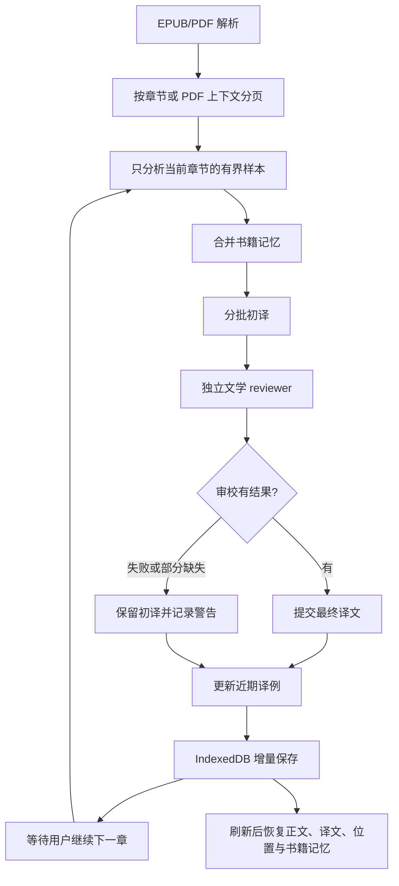

# 文学电子书翻译架构

## 为什么不直接复用网页翻译策略

网页翻译主要优化单页的可读性和响应时间；长篇 EPUB/PDF 还必须维护跨章节的实体、人物关系和整书文风。把整本书当成很多互不相关的网页段落处理，会让模型在每个请求中重新猜人名、称呼、叙述声线和隐含指代。

本实现沿用现有结构化片段、provider、chunk cache 和失败处理，但把文学增强限制在 EPUB/PDF 文档工作流。普通网页不会传入 `literaryContext` 或 `taskInstructions`，默认的网页 prompt 与缓存输入保持不变。

## 工作流

### 书籍记忆

每个文件会话维护一个有界 `LiteraryBookMemory`：

- **实体词典**：人名、别名、地名、重要物品、组织与概念，保存原文规范名和译名。
- **关系**：亲属、主从、敌对、师徒、拥有、地理隶属等关系，保留简短原文证据。
- **文风指南**：叙述视角、语域、句子节奏、人物对话差异、用词与修辞倾向。
- **章节摘要与近期译例**：只用于后续消歧与风格校准，设定数量上限，避免上下文随书长无限增长。

已有实体规范译名在后续章节合并时优先保留；新章节可以补别名和关系，不能静默把一个已有名字换成另一个译法。为避免实体记忆变成提示词注入入口，模型生成的数据先净化，再通过片段 `contextPath` 作为只读 user-data 传递，而不是拼进 system 指令。每段只带与当前正文匹配的少量实体；当正文主要使用代词时，退回带少量近期实体帮助消歧。

### 渐次翻译

- 单次模型请求有字符数与片段数预算，绝不上传整本书作为一个翻译请求。
- 文学模式启用章节/PDF 上下文边界切批，并严格按原书顺序推进，以便上一章建立的记忆能影响下一章。
- 每次点击只翻译一个尚未完成的章节/上下文单元；UI 显示全文批次数、当前分析章节、实体数量和 reviewer 完成数。用户继续时只提交未翻译片段。
- 初译每批成功后逐段提交；停止、失败或 reviewer 不完整时保留已有译文。审校失败不丢弃初译，并会在 UI 显示警告。
- **本机持久化**：解析完成后把结构化正文写入 IndexedDB 一次，之后只增量写入新译文/修订译文与小型进度快照。刷新或关闭阅读器后，可恢复最近一本书的正文、译文、页码、语言、显示模式、失败批次、书籍记忆、已分析章节键和文风审校统计，然后从缺失内容继续。
- 当前只保留**最近一本书**的恢复快照，避免多本大型 EPUB/PDF 长期占用扩展存储；选择新文件会原子替换旧快照。清除恢复记录仅删除本机这份文档阅读会话，不影响网页翻译缓存。
- 不保存原始 EPUB/PDF 二进制；保存的是本机解析后的文本片段，恢复时不需要再次解压或解析源文件。结构化文档、术语表与译文留在浏览器本地，不上传到 vocal-saga 做持久化。
- IndexedDB 不可用或存储空间不足时，阅读和翻译仍继续，但 UI 会显示自动保存失败的提示。

### Reviewer 的职责与边界

Reviewer 是初译之后独立的第二次模型调用，不是再直译一遍。它按顺序检查：

1. 原文细节、否定、视角、指代和人物关系是否准确。
2. 人名、地名和关键物品名是否符合书籍记忆。
3. 叙述声音、人物说话方式、节奏、潜台词是否一致。
4. 是否出现机械语序、模板化转折、解释性补句、重复总结、过度修辞或泛化的“AI 腔”。

审校应以“必要时修改”为原则。它不能为了追求表面流畅而补写事实、消除原文有意的沉默/重复/反讽，或把所有角色润色成同一种声音。程序只接收本批 ID 的有效结果；缺失的 reviewer 结果回退到初译。

## 服务端边界

新增电子书专用接口：

- `POST /api/translate/document/literary/analyze`：接收一个有界章节样本和现有记忆，返回合并后的记忆。
- `POST /api/translate/document/literary/review`：接收当前批原文与初译，返回逐 ID 的最终文本。
- `POST /api/translate/document/segments`：沿用既有结构化片段协议；只有格式是 EPUB/PDF 且显式打开文学模式时才运行 reviewer。

服务端继续复用既有 provider 与 cache 层。文学专用指令作为文档翻译的可选任务指令参与缓存指纹；普通网页调用不传此字段。书籍记忆随片段请求发送，不上传完整原始 EPUB/PDF。

## 实践依据

这套设计参考了可验证的外部实践，但没有复制其他项目的代码：

- [FluentRead](https://github.com/FluentRead/FluentRead) 的文档翻译工作台支持 EPUB/PDF 阅读、双语显示、编辑、暂停/继续、失败重试和导出；项目也将文档翻译、网页翻译分别描述为不同工作流。
- [TranslateBooksWithLLMs 的术语表实践](https://github.com/hydropix/TranslateBooksWithLLMs/blob/main/docs/GLOSSARY.md) 说明，分块翻译缺乏跨块记忆，显式维护人物/地点/组织的规范译名有助于长篇一致性。
- [Macken et al., EAMT 2022](https://aclanthology.org/2022.eamt-1.13/) 研究了文学翻译中的“机器翻译 → 后编辑 →（主要为单语的）修订”三阶段流程，并发现后编辑与修订产生的编辑类型并不相同。这支持把文风/品味修订做成独立阶段，而非只在初译提示词中要求模型“翻得更文学”。

以上资料支持的是分层、术语记忆和独立修订的设计方向，并不意味着模型 reviewer 可以替代人工文学编辑。

## 人工词典与保守审校

- 模型分析的实体和人物/事物关系默认是“待确认”；用户可在阅读器中编辑原文名、规范译名、别名及关系，并显式点击“确认”。确认状态随本地 IndexedDB 会话保存，后续章节会收到该记忆。
- Reviewer 只对明确影响事实、情节、指代/关系或规范译名的错误进行自动修正。语气、节奏、措辞等审美判断返回为可选建议，不覆盖正文。
- 审校记录保留分类、优先级、原文/译文证据、原因和建议；无法解析的审校输出按失败处理，保留初译。
